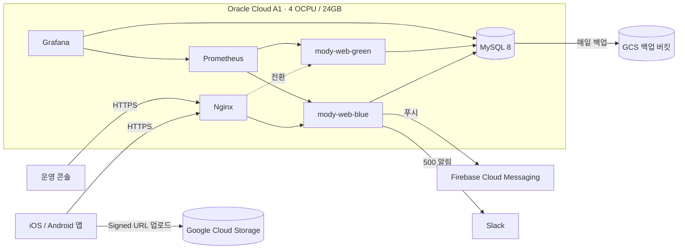

# mody

> 친구들과 함께하는 다이어트 습관, 모디

모디는 친구들과 함께 식사, 운동, 체중 기록을 공유하며 다이어트 습관을 이어갈 수 있도록 돕는 서비스입니다.
이 저장소는 모디의 Java/Spring Boot 기반 백엔드 API 서버입니다.

## Design Documents

- [ADR](docs/adr) (21건): 팀 논의 기반의 기술적 의사결정 기록
- [LLD](docs/lld) (36건): 기능 단위 구현 설계와 정책 정리

## How We Build

이 프로젝트는 **하네스 엔지니어링** 방식으로 개발합니다.
설계와 검증 장치를 먼저 고정하고, 그 기준에 맞춰 구현 품질을 관리합니다.

```text
Team Discussion
  -> ADR
  -> LLD
  -> Test Scenario
  -> Code Generation
  -> Human Review
  -> PR / CI / Deploy
```

팀 내부에서 논의된 기술적 선택은 ADR로 남깁니다.
ADR에는 선택한 방법뿐 아니라 고려한 대안, 트레이드오프, 후속 리스크를 함께 기록합니다.

ADR이 방향을 정하면 LLD에서 실제 구현 단위를 설계합니다.
API 요청/응답, 도메인 규칙, 예외 코드, 인증 조건, 저장 방식처럼 코드로 옮겨질 세부사항을 먼저 정리합니다.

LLD에서 예상되는 엣지 케이스는 테스트 시나리오로 명시합니다.
이 시나리오를 기준으로 코드를 생성하고, 사람이 diff와 테스트를 검토한 뒤 PR로 병합합니다.

Issue 생성, Commit 작성, PR 생성은 저장소 전용 스킬을 사용합니다.
반복되는 협업 작업의 양식을 일관되게 유지하고, 누락되기 쉬운 링크와 설명 형식을 고정하기 위함입니다.

## Technical Baseline

| Category | Stack |
| --- | --- |
| Language | Java 21 |
| Framework | Spring Boot 3.4.1 |
| Persistence | Spring Data JPA, MySQL |
| API Docs | Swagger, Spring REST Docs |
| Test | JUnit 5, MockMvc |
| Build | Gradle |
| Migration | Flyway |
| Push | Firebase Cloud Messaging |
| Storage | Google Cloud Storage (Signed URL 직접 업로드) |
| Deploy | GitHub Actions, Docker, Nginx (블루그린 무중단 배포) |
| Infra | Oracle Cloud A1 (prod), GCP Compute Engine (dev) |
| Observability | Prometheus, Grafana, Slack 알림 |

## Architecture



- **배포**: `main`에 머지하면 GitHub Actions가 amd64/arm64 이미지를 빌드하고 블루그린으로 교체합니다.
  새 색상이 헬스체크를 통과해야 Nginx가 트래픽을 넘기므로 배포 중에도 서비스가 끊기지 않습니다.
  스케줄 작업은 활성 색상 인스턴스에서만 실행됩니다. ([deploy/prod](deploy/prod))
- **환경**: `develop` → dev 서버, `main` → prod 서버로 자동 배포됩니다.
- **비용**: 운영은 Oracle Always Free, 개발은 GCP 무료 등급에서 운영합니다.

## Operations

| 영역 | 내용 |
| --- | --- |
| 모니터링 | Prometheus + Grafana 상주. 비즈니스·성능·사용자 지표(DAU/WAU/MAU, 가입 퍼널, 주간 코호트 리텐션) 대시보드 ([monitoring](monitoring)) |
| 장애 대응 | 500 에러를 Slack으로 알리고, 운영 봇이 원인을 분석해 GitHub 이슈를 자동 생성 |
| 일일 리포트 | 매일 09시 핵심 지표를 Slack으로 공유 ([scripts/daily-report](scripts/daily-report)) |
| 운영 콘솔 | Google 로그인 기반 관리 화면. 인증 피드, 챌린지·그룹 관리, 회원 관리, 신고 처리, 공지 푸시, 통계, 작업 이력 |
| 백업 | MySQL을 매일 GCS로 덤프, 30일 보관 |

## Project Structure

```text
src/main/java/cmc/mody
├── auth         # 소셜 로그인(Kakao, Apple, Google), JWT
├── member       # 회원, 프로필, 체중
├── grouping     # 그룹, 초대 코드, 구성원
├── record       # 식사·운동 기록, 댓글
├── challenge    # 걸음 수·주간 챌린지, 인증, 공유 이미지
├── notification # 알림 생성·발송(FCM), 리마인더 스케줄러
├── report       # 기록 신고
├── admin        # 운영 콘솔 API
└── common       # 공통 응답·예외, 업로드, ID 생성, 스케줄링
```

## Getting Started

로컬 실행은 기본적으로 `local` profile을 사용하며 MySQL 연결이 필요합니다.
DB 설정은 환경변수로 재정의할 수 있습니다.

```bash
./gradlew bootRun
```

```bash
DB_URL=jdbc:mysql://localhost:3306/mody
DB_USERNAME=root
DB_PASSWORD=...
```

## Verification

```bash
./gradlew build
./gradlew test
```
